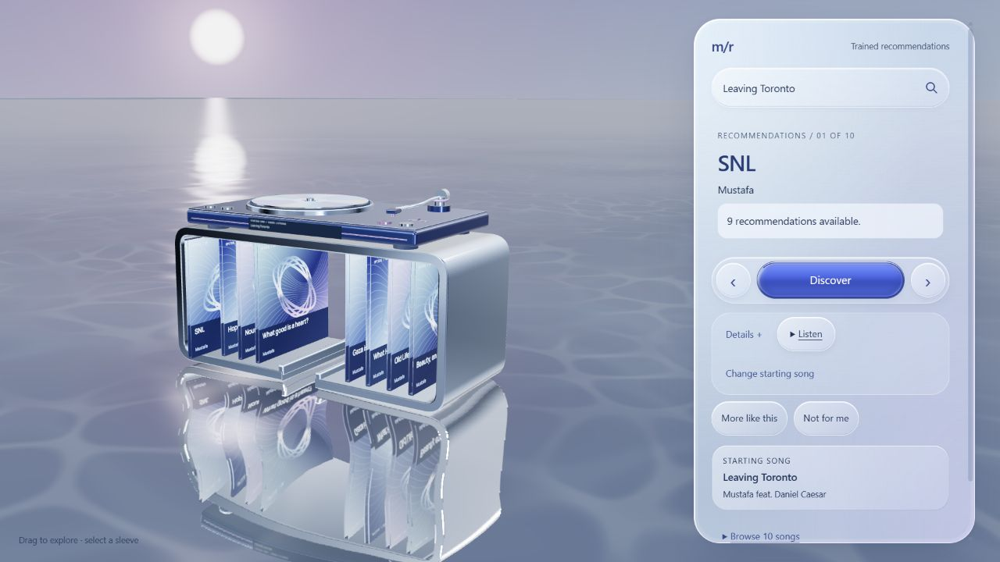

# Music Recommender demo

[Open the live application](https://project-3wvwg.vercel.app/) · [Watch/download the recorded walkthrough](https://github.com/pok0yo/music-recommender/releases/download/v0.1.0/music-recommender-demo.webm) · [Read the case study](case-study.md)

## Recording scope

Captured November 9, 2026 from the deployed public site at 1280×720 in a fresh automated Chrome session, using the real frozen model and v3 catalog. This is a scripted, silent walkthrough with explanatory chapter cards and a cursor overlay. There are no mocked responses, substituted rankings, private credentials or personal browser-profile contents. Recording begins after service startup; it is not a performance or cold-wake demonstration.

The recording is 38.8 seconds long. The screenshot above is the settled-scene capture from the verified November 8 activation of the same application source. The compact video was fully decoded during conversion and visually reviewed at six sampled points before upload.

## Walkthrough

1. Search for Leaving Toronto and confirm Discover to receive ten real recommendations.
2. Inspect shared-listening evidence and open the external listening-destinations menu. Search fallbacks are labeled; no provider audio is played.
3. Hide a recommendation with Not for me, then restore it with Undo. Feedback remains local and does not retrain the model.
4. Use SNL as the next seed, showing its truthful nine-result list, then return with browser Back.

The [release evidence](catalog-v3-activation.md) separately covers the 32-starter sample, empty-list confirmation guard, unsupported-seed recovery and other public checks. A short recording does not replace that evidence or establish recommendation usefulness, physical-device support or load capacity. Free hosting may need time to wake when opening the live app.

## Media provenance

The screenshot and recording show the application's existing interface and permitted display metadata; no album covers, provider audio or external playback footage are added. Underlying visual/source attribution remains in [THIRD_PARTY_NOTICES.md](../THIRD_PARTY_NOTICES.md). The recording is distributed as a GitHub release asset so that a binary video does not inflate source history. Its hash, size and capture checks are recorded in [closeout evidence](evidence/project-closeout.json).
