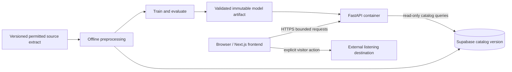

# Stage 5 — implementation plan and milestones

Status: planning complete; implementation not started. Prepared 2026-10-16. All effort estimates, thresholds, contracts, and architecture below are proposals unless explicitly identified as verified. Stage 6 requires the user's next go signal.

## 1. Assumptions and scope

1. Established recognizable mainstream tracks are the immediate priority. Comprehensive recent-release coverage is unresolved, not promised.
2. Outbound listening links remain provisional pending the user's approval. Built-in previews and full playback are not dependencies.
3. The visitor starts with one supported recording and receives up to ten related recordings without an account. The system has no visitor listening history.
4. One person builds the project. Weekly availability, hardware, disk space, and hosting budget are unknown. The 6–8-week target is conditional on these inputs and data feasibility.
5. ListenBrainz events and MusicBrainz core metadata are candidate inputs, not an approved or validated dataset. Source documentation does not prove that an extract contains usable fields, timestamps, or mainstream coverage.
6. The five visual directions in [Stage 4](stage-4-design-plan.md) remain independent alternatives. None is selected. Initial hero areas stay flat CSS stand-ins with the specified geometry; no imagery will be sourced or generated.
7. The repository stays private unless the user requests a visibility change. A publicly accessible application is a future release deliverable, not evidence that the repository must already be public.
8. Routine milestone commits and pushes are authorized. Application implementation, dataset processing, and deployment follow their respective stage boundaries.

**Release scope:** catalog search, seed disambiguation and selection, grounded related-track results, Details, available external links, reseeding and browser Back, About/methodology, and all specified failure states. No accounts, persistent profiles, feedback collection service, streaming, social features, playlist export, generative explanations, or live retraining.

This deliberately limits the product while retaining substantive engineering: reproducible preprocessing, a baseline and collaborative model, leakage-aware evaluation, a versioned serving artifact, a typed API, and a tested accessible client.

## 2. Evidence and unresolved constraints

### Verified planning state

- The repository contains a README, ignore rules, and the Stage 4 design specification. There is no application, installed project dependency set, trained model, or measured recommendation result.
- Stage 4 specifies the journey, states, five palettes/layouts, exact hero reservations, proposed typography, and future accessibility checks. Its contrast arithmetic is not rendered accessibility verification.
- Earlier documentation review identified ListenBrainz listens as CC0 and MusicBrainz core data as CC0. MusicBrainz supplementary data has different terms; tags and genre associations must not silently enter the core-only pipeline. Exact selected files, included fields, provenance, and applicable terms still require the Stage 6 audit. Sources: [ListenBrainz data](https://listenbrainz.org/data/), [MusicBrainz database](https://musicbrainz.org/doc/MusicBrainz_Database).
- Recording identifiers and mappings can be missing or unreliable. Title/artist recognition does not demonstrate sufficient co-listening support. See the [ListenBrainz listen format](https://listenbrainz.readthedocs.io/en/latest/users/json.html).

### Hosting documentation checked for Stage 5

- Vercel Functions have plan/runtime-dependent bundle, memory, and duration limits. This supports measuring deployment fit; it does not establish that Python inference is impossible on Vercel. The separate container is a lifecycle and operational choice. [Vercel limits](https://vercel.com/docs/functions/limitations).
- Supabase supports trusted-server database connections; its Data API can be disabled when unused. Secret/service-role keys bypass RLS and must not reach the browser. [Supabase security guidance](https://supabase.com/docs/guides/database/secure-data).
- Render's free web services sleep after 15 minutes without inbound traffic and take about a minute to wake, according to its documentation. Local files are ephemeral. Render is a candidate, not a selected or provisioned host. [Render free service limits](https://render.com/docs/free).

No deployment account, quota, region, paid plan, credential, API access, playback permission, or production endpoint has been verified for this project. Recheck relevant terms and limits when selecting an actual deployment plan.

## 3. Architecture and responsibilities

Proposed minimum: one Next.js application, one FastAPI service, one Supabase PostgreSQL database for catalog metadata, and an offline Python pipeline. No queue, vector database, Redis, Kubernetes, or separate training service.



The arrows describe proposed responsibilities, not deployed infrastructure.

### Offline Python

- Download only an approved, bounded extract after examining size and sampling method. Preserve source URL, checksum, terms, field provenance, and retrieval date.
- Stream/chunk normalization where necessary rather than loading a full export into pandas. Use pandas/NumPy where they fit the measured extract.
- Produce normalized events, ID mappings, split manifests, train-only statistics, model artifacts, evaluation outputs, and an app catalog projection.
- Keep listener identifiers and event histories in the offline workspace. Do not publish them through the app, logs, Git, or portfolio examples.
- Store raw/intermediate/processed data and model artifacts outside Git using the existing ignore rules. Preserve the reproducible acquisition recipe and checksums in Git.
- No model fitting or third-party metadata lookup in an HTTP recommendation request.

### FastAPI and PostgreSQL

- FastAPI owns input validation, catalog search, artifact compatibility, recommendation lookup, reason codes, and bounded response shapes.
- Supabase stores a small serving catalog, not the full event history. Start with versioned recordings and release metadata: recording ID, title, artist credits/IDs, optional version/year, permitted external URLs, source provenance, and catalog version. Add a separate relational table only where an actual query requires it.
- Use a dedicated database role with SELECT on the required serving tables. The import/migration role is separate and never used by the public API. Keep the Data API disabled if unused; if exposed later, configure and test RLS and grants before use.
- Parameterize search queries; cap query length and result count; use deterministic ordering. Begin with normalized title/artist search and a measured query plan. Add a search index only when the selected catalog and queries justify it.
- The API queries an immutable catalog version named by its artifact, not a mutable latest row set. Import new versions alongside the old version before switching releases.
- Load the validated neighbor artifact once at process startup. Begin with one worker; measure memory before adding workers because each process may duplicate artifacts.

### Frontend and integration

- One Next.js/React/TypeScript client holds the shared discovery state and accessible interactions. Tailwind/custom CSS supplies tokens; use only needed shadcn/ui components.
- Browser requests go directly to the public read-only FastAPI API over HTTPS. Configure exact production and approved preview origins. This avoids an unnecessary Next.js proxy; the tradeoff is explicit CORS and two deployments.
- CORS is not authorization or abuse protection. Keep endpoints read-only, constrain work per request, cap database connection concurrency, set timeouts, and apply host-level rate limits if available. A single-instance limiter is only an explicit small-demo fallback, not a distributed guarantee.
- Browser-visible configuration contains only the API base URL and nonsecret release identifiers. Database credentials and artifact storage credentials remain server-side.
- Do not store searches or feedback by default. Minimal operational logs contain request ID, route, status, duration, and model version; omit raw queries, listener histories, and secrets. Document hosting logs and retention at deployment.
- External links are validated HTTPS destinations from permitted metadata; never fetch an arbitrary visitor URL server-side. Label destinations/new-tab behavior. Link absence is an ordinary unavailable state.

## 4. Proposed repository structure

Create these paths only when their stage needs them; this tree is not a request to scaffold now.

```text
app/                     Next.js routes: discover, about, prototype previews
components/              Shared accessible controls and discovery behavior
lib/                     Small API client and shared frontend types
v1/                      Blue Horizon presentation and tokens
v2/                      Disc Study presentation and tokens
v3/                      Pearl Orbit presentation and tokens
v4/                      Capsule Current presentation and tokens
v5/                      Cobalt Signal presentation and tokens
backend/                 FastAPI service, schemas, API tests
ml/                      Preprocessing, models, evaluation, Python tests
supabase/migrations/     Catalog schema and least-privilege grants
tests/                   Shared UI fixtures and browser tests
docs/                    Existing plans and future evidence/release documentation
.github/workflows/       CI, introduced alongside executable checks
```

Use one Node dependency set and one Python environment initially; pin resolved versions after compatibility is checked. Keep training dependencies out of the deployed API image where they are not used. `implicit` is optional; no dependency is added merely because it appears in the preferred stack.

The literal root folders `v1/` through `v5/` contain separate presentation modules, not five duplicated applications. Preview routes `/variants/v1` through `/variants/v5` use the same behavior and fixture interface. Each direction owns its composition, typography, surfaces, and hero placement. Shared controls must not flatten these differences into five palette swaps.

At selection, `/discover` uses one direction. Keep comparison sources and evidence in Git; omit unused variant routes and fonts from the public release. Demonstration fixtures must never become the fallback for an unavailable real API.

## 5. Data-to-UI contracts

### Catalog identity and supported coverage

- Use an audited canonical recording ID, preferably the resolved MusicBrainz recording UUID. Keep source-ID mappings and unresolved records separately; do not collapse live/remix/remaster versions by title alone.
- Search the frozen serving catalog, not a third-party universal music catalog. Explain catalog limits when no match exists. A recording may be searchable but have too few supported neighbors.
- Display enough real metadata for disambiguation; omit unknown fields rather than inventing dates, albums, or versions. Keep music titles and artist names in their original Unicode form.
- Define `catalog_version`, `model_version`, `artifact_schema_version`, and `data_mode` in contracts. A catalog version includes a checksum of its exported content and identity mapping.

### Proposed API surface

| Endpoint | Responsibility |
|---|---|
| `GET /v1/catalog/search?q=...&limit=...` | Search title/artist; bounded, stable ordering. |
| `GET /v1/catalog/starters` | Small versioned list of actually supported seed tracks. |
| `GET /v1/recommendations/{recording_id}?limit=...` | Seed metadata, related results, separately labeled alternatives, versions. |
| `GET /health/live` | Process liveness; no sensitive configuration. |
| `GET /health/ready` | Artifact loaded and compatible catalog reachable; otherwise 503. |

Proposed bounds: trimmed search of 2–200 characters, search limit 1–20, recommendation limit 1–10. Validate UUIDs and reject unknown parameters that would change scoring. No arbitrary SQL, model URL, or artifact path input. No separate track-detail endpoint initially: result metadata and evidence support the Details panel.

A recommendation response contains:

- `seed`, `results`, and separate `alternatives` arrays; each item has recording ID, title, artist credits, optional disambiguation, and nullable external link.
- A result `reason_code`, such as `shared_listeners`; evidence fields must derive from the loaded model's training data. Popular alternatives use `training_popularity` and are visibly distinct.
- `status`: `ok`, `limited`, or `no_connections`; list sizes are explicit. Zero valid neighbors is not a server failure.
- `meta`: model/catalog versions, training cutoff, method label, and `data_mode` (`real` or `demo`). Demo mode is a separate preview/test configuration with a persistent visible label.

Do not expose a similarity score as an enjoyment percentage. Default explanation: “Connected through shared listening in this dataset.” Details can describe the method and support limitation. Never say “similar tempo,” “matches your mood,” or “people like you” without the corresponding data and method. Exact shared-listener counts are optional, aggregate, thresholded, and never accompanied by listener identities.

Use 422 for invalid inputs, 404 for a well-formed ID absent from this catalog, 429 with retry information when throttled, and 503 for unavailable dependencies/readiness. Errors use a consistent safe code/message/request-ID shape. Empty search is a successful response with an empty array. A dataset mismatch fails readiness; it must not serve mixed releases or silently substitute fixtures.

Generate OpenAPI from Pydantic and check representative JSON against frontend types. Begin with a small explicit TypeScript contract and fixture tests; introduce code generation only if contract churn makes it useful.

UI behavior follows Stage 4: explicit search submission; stale request cancellation/ignore; old results retain the old seed while searching; selecting a new seed clears stale results; URL state supports shareable seed and Back; errors preserve recoverable input. Loading has no invented progress percentage.

## 6. Dataset and recommendation pipeline

### Stage 6 feasibility gate

Before costly processing, record the exact source version, compressed/uncompressed estimates, schema sample, license coverage by field, sample-selection method, and available machine resources. The previously reviewed full export is too large to assume it fits a personal workstation; a small sample may be too sparse. Neither size nor “sample” status proves suitability.

Audit mapping success and ambiguity, duplicate listens, timestamp validity/range, listener activity distribution, unique recordings, artist/era coverage where metadata exists, item support, neighbor availability, memory, disk, and run time. Avoid arbitrary event truncation that strips listener histories without recording its effect.

Proposed pass criteria, fixed before model comparison:

- A user-agreed panel of 40 mainstream recordings across desired artists/genres/eras; at least 80% resolve into the eligible catalog with sufficient training support and at least three qualifying other-recording neighbors. Report separately how many can return ten. This operationalizes “supported”; it is not a universal quality standard or a measured result.
- Each validation/test window supports at least 500 scorable queries and 100 distinct seed recordings under the protocol below. Show both counts and the excluded share.
- Source permissions and field provenance are documented; selected data can be reproduced within available storage and memory; processing completes within an agreed local resource budget.

If these fail, report the failure and the scope it affects. Investigate a better justified extract or source, or seek an explicit scope revision. Do not silently lower thresholds, call obscure-only coverage mainstream, or replace real recommendations with fixtures. A coverage failure can block the promised MVP.

### Reproducible preprocessing

Keep immutable raw inputs; record hashes. Normalize events into listener ID, recording ID, event time, optional ingestion time, source, and mapping status. Deduplicate genuine repeated records according to a documented key without deleting legitimate repeat listening. Preserve repeat events for audit; use binary listener–recording interactions for the proposed collaborative model.

Separate source cleanup from statistical fitting. Select train-eligible items using training events only; fit popularity, support thresholds, weights, and any learned preprocessing on train. Version metadata snapshots and mappings, and explain any retrospective identity enrichment. Produce rejected-record counts with reasons and split boundary checks. Re-running the same inputs/configuration must reproduce split membership and artifact checksums, allowing only explicitly documented nondeterminism.

Do not materialize a dense all-item similarity matrix. Compute sparse/blockwise similarities and retain the top supported neighbors needed for serving; measure temporary memory use. Exclude the seed, duplicate canonical IDs, and ineligible items. Use stable ID tie-breaking.

### Models, cold start, and explanations

1. **Baseline:** rank by distinct training listeners, excluding the seed. Label it dataset popularity, not personalized relevance.
2. **Primary experiment:** binary item-based collaborative filtering. For shared-listener count `c_ij` and item listener counts `n_i`, `n_j`, use `c_ij / sqrt(n_i * n_j) * c_ij / (c_ij + lambda)`.
3. **Initial proposed settings:** training item support at least 5 listeners, edge support at least 3 shared listeners; compare shrinkage `lambda` in `{0, 10, 50}` on validation. These values are hypotheses. Record changes before test use; do not imply they have been optimized.
4. **Optional experiments:** ALS only if density, time, and resources justify it; evaluate seed-to-item similarity with the same one-seed input, not a hidden full visitor history. A metadata hybrid needs permitted useful features and an ablation. Neither is required to finish.

A new visitor needs no history: offer verified starter seeds and search. An unknown recording prompts another search. A sparse known seed returns a short list or no connections with separately labeled popular alternatives. Do not fabricate edges or pad the related list with popularity. Prolific listeners can still bias a binary matrix; inspect this before adding a weighting experiment.

## 7. Frozen evaluation protocol

This makes the Stage 3 proposal durable. Exact dates and feasible thresholds are determined during the source audit, then frozen before model comparisons.

1. Propose six months of training before a global cutoff T1, the next 28 days for validation, and the following 28 days for test. Verify adequate timestamp coverage first. No random event split or independent per-user last-event split presented as chronological deployment.
2. For each listener/window, use their first valid event in the window's first 21 days as the seed; choose it without examining future targets. Targets are distinct other recordings listened to in the next seven days, contained within that window. Fix boundary inclusivity and time zone in code and test them.
3. Produce one query per listener per window. The model receives only the seed. Freeze candidate catalog C from train, and rank all of C except the seed for every model. Do not give the evaluator's user history to one algorithm or filter previously heard items from the serving ranking.
4. Count unsupported seeds, zero-target queries, out-of-catalog targets, and queries whose targets are all outside C. Score ranking metrics on supported seeds with at least one in-C target, report that denominator and its share of all constructed queries, and report target coverage separately. This conditional score must not hide end-to-end catalog failures.
5. Tune on validation only. Freeze code, parameters, candidate set, and metric definitions before final test evaluation. Compare all models trained on the original training interval. A later deployment refit is a separate artifact, not assigned the old test score as if measured on that refit.
6. Listener overlap across time windows is permitted for the chronological use case, but no validation/test interactions enter training or explanation counts. Fit support filtering/popularity only on train. If ingestion time is missing, label results retrospective by listen time rather than claiming knowledge available at a historical deployment date.
7. If timestamps cannot support this protocol, explicitly revise the task/protocol before experimentation. Do not conceal a change to a listener-disjoint or random split.

**Primary metric:** macro NDCG@10 with binary future-listen relevance. Also report Recall@10, optional Precision@10, catalog coverage (unique recommended items / C), list completeness, unsupported/fallback rates, and counts by support cohort (proposed 5–19 versus at least 20 training listeners). Missing list positions receive no relevance credit; denominator conventions are fixed across models.

Report mean per query/listener and a secondary seed-balanced view so very common seeds do not dominate interpretation. Report paired differences against popularity and 95% bootstrap intervals by resampling listeners with fixed published random seeds. These quantify uncertainty within the observed sample, not representativeness of all music listeners.

Artist variety is a labeled diversity proxy with artist-metadata coverage reported. Intra-list feature diversity is optional and requires the same independent feature space and missing-data treatment across models; do not compare model-specific embedding distances as equivalent diversity scores. Use the same full candidate catalog, not sampled negatives that artificially simplify ranking.

Future listening is an implicit co-listening proxy, not proof of enjoyment, novelty, or causality. A secondary novel-to-observed-history target analysis may help, but keep its candidate set/ranking unchanged and disclose incomplete historical observation. Later small qualitative sessions assess discoverability and usefulness separately; do not turn a few interviews into a population accuracy claim.

Stage 7 succeeds with correct reproducible comparisons and an honest model decision, not a required invented uplift. If CF fails to beat popularity, inspect leakage, support and failure cohorts; report the result. Shipping it still needs a defensible useful seed-relationship behavior. A pure popularity fallback does not fulfill the proposed related-track product by itself.

Method references from the earlier review: [item-based collaborative filtering](https://www.ra.ethz.ch/CDstore/www10/papers/519/), [implicit-feedback factorization](https://yifanhu.net/PUB/cf.pdf), [global-timeline leakage](https://arxiv.org/abs/2010.11060), and [sampled evaluation metrics](https://research.google/pubs/on-sampled-metrics-for-item-recommendation/).

## 8. Serving artifact and release integrity

- Export immutable neighbor IDs, scores, and permitted aggregate evidence plus a JSON manifest. Prefer numeric NumPy arrays with pickle disabled and plain JSON over executable object serialization. Never load an untrusted Joblib/pickle artifact.
- Manifest fields: model ID, schema version, catalog/mapping checksums, source and split IDs, training interval, algorithm/parameters, code commit, environment lock identifiers, artifact checksums, item counts, and evaluation report reference.
- Validate finite scores, in-catalog IDs, no self-links/duplicate neighbors, stable ordering, reason/evidence consistency, and expected shapes before publication. Estimate expanded memory size, not merely compressed file size.
- For a small measured artifact, package it into a versioned API container during release. If size makes that impractical, fetch a pinned immutable object from private storage at startup and verify its checksum before readiness. Choose one delivery path after measurement, not both now.
- No live model hot swap in the first release. Deploy an image pinned to an artifact and catalog version; check readiness, then route traffic. Retain the previous complete release and catalog for rollback. Database changes are additive until rollback is no longer needed.
- Store generated artifacts outside Git. If sharing a downloadable model later, review the actual artifact's data exposure and source terms first. A portfolio report contains aggregate evidence, not raw listener records.

## 9. Milestones, effort, and critical path

The plan estimates **106–150 focused hours**, plus **16–24 hours contingency**, for **122–174 hours total** after planning. These are planning ranges, not measured velocity. A six-week schedule needs roughly 21–29 hours/week; an eight-week schedule needs roughly 16–22 hours/week. At 10 hours/week, expect roughly 12–18 weeks. These assume data passes promptly; hardware or source failures can extend any estimate. Calendar dates await actual availability.

| Stage | Focused effort | Intended window |
|---|---:|---|
| 6: audit and preprocessing | 18–26 h | Week 1 into week 2 |
| 7: models and evaluation | 22–30 h | Weeks 2–3 |
| 8: FastAPI service | 12–18 h | Week 4 |
| 9: five prototypes and chosen frontend | 28–38 h | Weeks 5–6 |
| 10: integration and end-to-end checks | 12–18 h | Weeks 6–7 |
| 11: production validation and portfolio | 14–20 h | Weeks 7–8 |

Weeks overlap at handoffs, not because one person has parallel full-time capacity. Include focused hours for tests, documentation, and fixes inside each stage. Approval/review delays and optional experiments are not guaranteed to fit these ranges.

### Stage 6 — dataset audit and reproducible preprocessing

Depends on: next go signal, source availability, machine/resource budget, and agreed mainstream panel.

Deliver: provenance/terms record, reproducible bounded acquisition and preprocessing, data-quality/coverage report, frozen split/candidate manifests, and pass/revise decision against section 6. Minimum evidence includes actual RAM/disk/runtime observations and excluded-record denominators. Start with a small schema probe before a larger download. Stop and reassess if source/coverage fails; do not proceed to the app on assumed feasibility.

### Stage 7 — model implementation and evaluation

Depends on: Stage 6 pass and frozen protocol.

Deliver: deterministic popularity and supported item-CF, targeted correctness/leakage tests, validation comparison, final held-out test report, failure/cohort analysis, and validated serving export. One recorded command sequence must reproduce results from pinned inputs. Acceptance requires evidence-linked explanations, seed exclusion, stable ties, the same candidate set for all models, reported exclusions/uncertainty, and no test-driven parameter choice. Optional ALS/hybrid work needs remaining time and a concrete hypothesis.

### Stage 8 — FastAPI recommendation service

Depends on: compatible catalog/artifact, confirmed serving resource envelope.

Deliver: versioned routes/contracts from section 5, catalog migration/import, read-only database access, readiness behavior, structured safe errors, CORS/limits, API tests, and generated OpenAPI documentation. The API must run locally from documented setup without training on startup; reject invalid inputs, fail cleanly on mismatched/corrupt artifacts, and recover after a dependency outage. Verify a real model response separately from synthetic test fixtures.

### Stage 9 — visual prototypes and selected frontend

Depends on: Stage 4 specification and Stage 8 contract; final real-data behavior requires the real API.

Deliver all five root folders with equal functionality and the same named fixture suite: entry, search/no match, loading, 0/1/10 recommendations, long/Unicode text, missing metadata/link, and API errors. Reserve every hero at its Stage 4 position/aspect with a flat CSS fill. Use one shared behavior layer; make each presentation fully its own direction. Suggested allocation within this stage: 12–16 h for five bounded prototype views, 4–6 h for comparison, 12–16 h for the selected responsive frontend.

Compare clarity, accessibility, aesthetic fit, responsiveness, and cost using the Stage 4 rubric and actual screenshots/interaction evidence. No scoring before rendering. User selects the direction after comparison; then finish its Discover and About screens and all states. This is an explicit selection gate within Stage 9, not permission to silently choose now. If five credible variants exceed the allocation, report the estimate change; do not omit variants or reduce them to palette swaps without agreement.

### Stage 10 — integration and end-to-end testing

Depends on: selected frontend and real API.

Deliver: tested search → select → related results → Details → available link → reseed → Back path; stale-response/race recovery; bad IDs; missing/sparse data; API timeout/outage/rate-limit behavior; keyboard, zoom, mobile, reduced-motion, and screen-reader status checks. Fixtures support deterministic tests; a separate real-data smoke record verifies the active model/catalog. Never present fixture tests as evidence of real recommendation quality.

### Stage 11 — production validation, deployment, and portfolio

Depends on: integration pass, hosting/budget decisions, reviewed release configuration and chosen direction.

Deliver: public demo, release artifact/version manifest, secret and access checks, production smoke results, measured cold/warm latency and memory, rollback rehearsal, deployment/runbook documentation, aggregate evaluation report, design comparison, and truthful case study. Recheck platform limits and source/link/font permissions against what is actually shipped. Verify the public URL works without the developer's login; no placeholder deployment link in the README.

Proposed performance budget: warm API p95 under 500 ms for bounded search/recommendations at five concurrent clients; browser seed-to-results p95 under 2 seconds on a stated device/network. Measure each endpoint with a documented seed/query sample and at least 100 requests after warm-up, report errors, sample size, and environment. Cold starts are measured separately and disclosed. These are acceptance targets to validate/revisit openly, not current performance claims or an availability SLA.

The critical path is **source/coverage → reproducible splits → model evidence/artifact → API → chosen frontend → real integration → deployment**. Written design exploration is already available; visual polish cannot substitute for a failed data gate.

## 10. Testing and CI plan

| Layer | Necessary evidence |
|---|---|
| Preprocessing | Known duplicate/mapping cases, invalid timestamps, split boundaries, stable IDs, rejected-row accounting. |
| Leakage | Mutating held-out events cannot change train statistics, candidates, popularity, fitted parameters, or artifact. |
| Ranking/metrics | Small hand-calculated examples for cosine/shrinkage, ties, seed exclusion, NDCG/Recall, short lists, zero targets. |
| Artifacts | Checksums, ID alignment, finite values, shape/schema compatibility, corrupt/mismatched startup failure. |
| API/database | Validation limits, empty versus error responses, timeouts, parameterized search, read-only role rejects writes, no anonymous Data API exposure. |
| Frontend | State transitions, stale-response protection, distinct real/demo status, accurate explanations, Back restoration. |
| Browser | Complete user journey, 320/390/768/1024/1440 px, 400% reflow, keyboard/focus, reduced motion, accessible status updates. |
| Production | Public access, active versions, known-seed response, DB outage recovery, measured latency/memory, rollback. |

Use pytest for Python, Vitest for meaningful client state/contract tests, and Playwright for browser flows when implementation exists. Automated accessibility checks supplement manual keyboard and screen-reader inspection. Validate both entry and results layouts; test unavailable images preserve hero geometry. No need to write tests for the planning documents themselves.

CI starts with the first executable component: Python tests/static checks and fixture artifact validation; later TypeScript checks, lint, UI tests and production build; finally deterministic browser smoke tests. Pin dependencies and record runtimes. Keep real source acquisition/training and deployed service checks in explicit jobs/runs rather than redownloading datasets on every commit. CI must run without production secrets or live provider access for ordinary checks. Do not set a cosmetic coverage percentage in place of testing the listed failure modes.

Make a meaningful commit at each tested stage/sub-milestone, review the diff for data/secrets, push, and verify the remote commit. Failed tests are documented and resolved or explicitly scoped before claiming completion. Do not force-push published history or commit generated datasets.

## 11. Portfolio evidence and release deliverables

Create documentation as the associated work exists, not empty reports now:

- README: problem, current capabilities, actual demo URL, local setup, reproducible commands, limitations, and status.
- Product/design evidence: existing plans, final decisions, five equal-content captures, selection rationale, accessible interaction walkthrough.
- Data report: source/file/version/terms, acquisition recipe, mapping quality, coverage, selection bias, rejection counts, and resource observations.
- Evaluation report/model card: task, split, candidate definition, baseline/model configuration, actual tables and uncertainty, cohorts/failures, artifact version, and what did or did not improve.
- Architecture/API/runbook: updated diagram, OpenAPI, environment-variable names without values, database permissions, deployment and rollback steps.
- Verification record: actual commands/results; separate unit/contract tests, browser interaction evidence, manual accessibility inspection, real-data smoke tests, and measured performance.
- Case study: personal contribution, constraints, engineering choices, visual process, observed outcomes and limitations. Use “designed” for proposals, “implemented” for working code, and “measured” only for recorded experiments. No invented users, study findings, or uplift.

Repository visibility, screenshots, and public artifacts receive a final secrets/data review before publication. A private repository with a real public demo is possible; decide what reviewers should be able to inspect before release.

## 12. Scope cuts, risks, and decisions requiring input

Cut optional ALS/hybrid experiments first, then nonessential motion/material polish and extra presentation pages. Keep the popularity comparison, CF correctness, honest explanations, five bounded variants, accessibility, error states, leakage checks, and reproducibility. Do not add authentication to justify Supabase or a feedback system to imply personalization. If required work still exceeds 8 weeks, change the timeline explicitly.

| Decision | Needed by |
|---|---|
| Weekly hours; RAM/free disk; permitted compute/hosting budget | Stage 6 sizing and calendar commitment. |
| Must-support artists/genres/eras; established tracks versus recent releases | Freeze the 40-track audit panel before testing coverage. |
| Approve outbound links as the initial listening action | Before finalizing playback-related product scope; before Stage 9 actions. |
| Final aesthetic among v1–v5 | After rendered comparison in Stage 9. |
| Hosting plan and repository visibility | Before public release in Stage 11. |

Main risks are insufficient mainstream interaction density, biased or outdated samples, costly source processing, ambiguous recording identity, overfitting a small validation set, five-variant design effort, and a sleeping demo service. Each has a gate or a measurable check above; none is resolved merely by documenting it.

## 13. Stage boundary and completion record

Stage 5 adds this plan and updates the README. It does not create application folders, install packages, download data, train models, create cloud services, generate/source imagery, or run application tests.

Document checks should verify scope consistency, local links, milestone arithmetic, Git diff hygiene, and absence of unintended files. Code/browser/model tests remain future evidence. The next stage eligible for authorization is Stage 6 only: feasibility audit and reproducible preprocessing, beginning with source/resource and representative-catalog checks.
